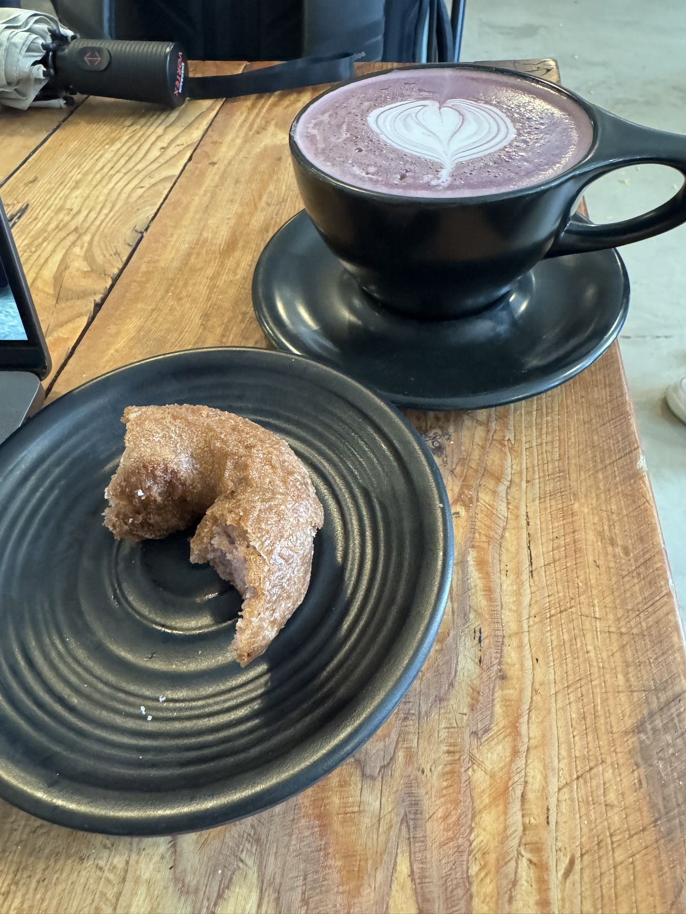
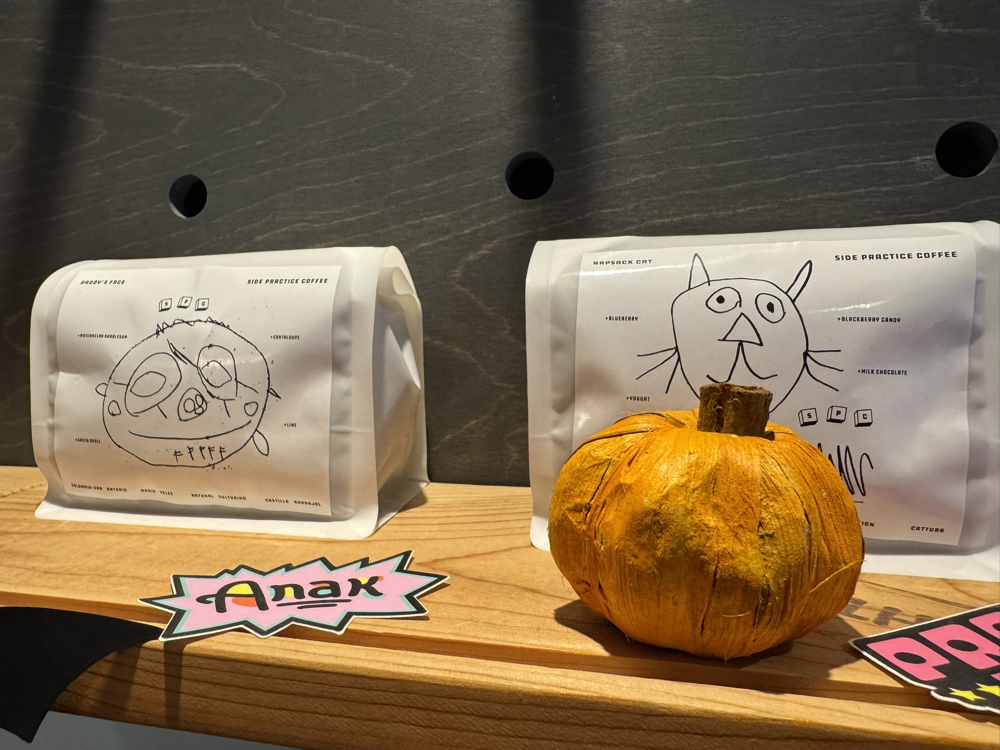
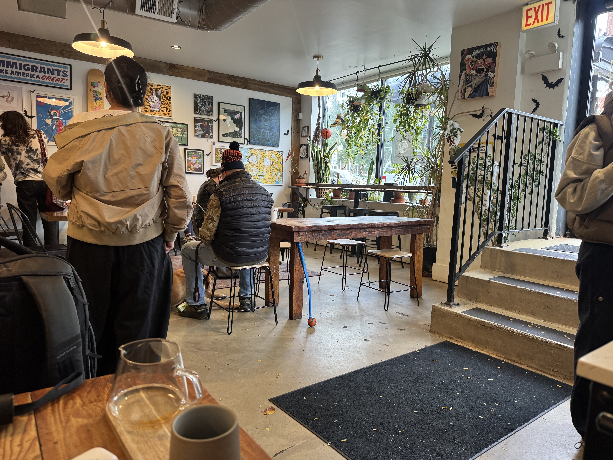
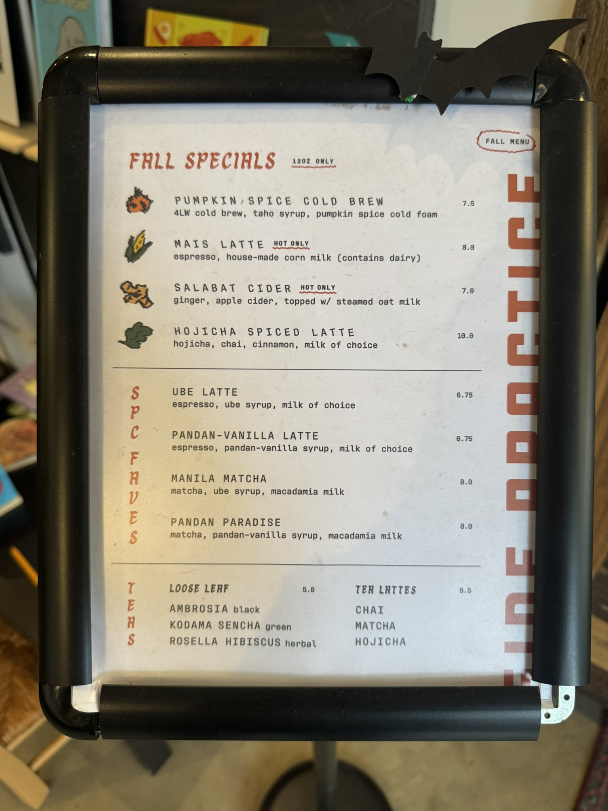
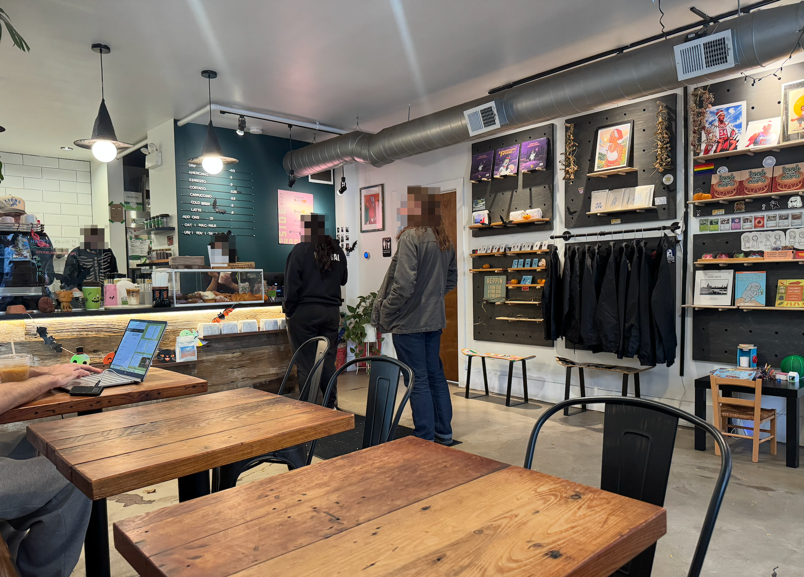
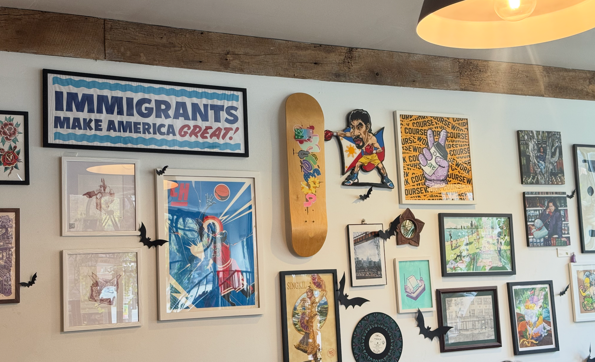
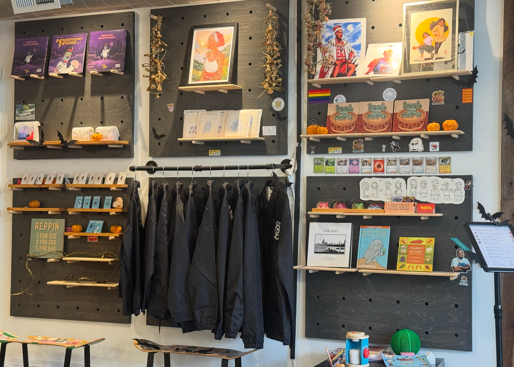

import AccordionPhotoTemplate from '@components/Accordion/AccordionPhotoTemplate.astro'
import InlineEmoji from '@components/ImageComponents/InlineEmoji.astro'
import EmojiBlockquote from '@components/EmojiBlockquote.astro'

## Coffee

_A shame that ube has been "influencer'd" because it really blends well with coffee's bitterness_

The coffee is insane here. Side Practice regularly sources extremely high quality coffees from niche local roasters, and I have yet to be disappointed by a roast--so I'm confident they do their own QA before selling a drink.

_Kind of obsessed with this goofy bag art_

They also regularly offer at least 2, sometimes 3 pour over coffee options each time. My most recent visit was my first time getting to try their own bespoke roasted coffee, and it absolutely delivers. Top-notch stuff.

In my opinion they well-earn their 10/10 just for the consistency of quality and the relative variety I can expect to find here. I will say that compared to a shop like Dayglow (review WIP) where the coffee rarity is part of their identity, it doesn't *feel* like Side Practice cares to tell you how good their coffee is. Which is totally fine!\
Like [Pedestrian](/cafe-reviews/pedestrian-belmont), their focus seems to be on their identity as a space and on quiet quality.

This is also a rare cafe I enjoy getting lattes from. Nearly always decaf, but I like their syrups, especially their ube. I mostly care about the black coffee on its own, of course, but this helps make the cafe more appealing for guests I bring with me, and that's a big get. 

## Cafe

The cafe is a pretty perfect size to fit into the "cozy" category in a way I really enjoy. It's set on a corner and an immediate step-down (not-accessible, so minus points there) into a very underground concrete space softened by fantastic art all over the walls and tasteful merch.

They have a ton of plants by their main big windows, and they're clearly well-taken care of (even if they're mostly easy snake and pothos plants).

I will say it can get pretty busy here, and if you're unlucky you won't get a space. They currently have 8 2-person cafe tables, 1 4-person communal table, and 4 bar seats at the window.

No outdoor seating. And sometimes tables are removed if they're doing a food pop-up with a local food vendor.

## Price

In October 2026 it's hard to rate price since things are getting so expensive so fast, but I feel like for the quality I generally pay a very fair, maybe too-cheap price for the quality of drinks I get here. Pour-overs are usually around the $9 range, but I have definitely (memorably) paid $14 for one here in the past (super worth).

## Productivity

The hardest part of productivity is getting here--it's on Damen and Foster ave, and both of those buses kind of suck in my personal experience. So it can take a bit of time to get here, and since they're only open from 7a-3p my time as an afternoon coffee goblin is somewhat limited.

But once here, it's pretty easy to be productive. It doesn't get too loud, they don't play loud music, and most of the tables and bar seating have outlet access if you need to plug in.\
I will say that they also have soundless anime or tv playing on a projector against the wall, so if you're easily distracted make sure you sit underneath it to avoid the temptation to watch.

## Vibes

Incredible vibes. You can tell that this is a community shop run by friends and neighbors. All the art here is proudly local and very Filipino & pro-immigrant. You love to see it.

I'll say that it's a shame there's no seating that allows me to do my favorite thing at coffee shops: hang out and talk to the baristas. But even so, the folks here are super nice and fun to talk to even just for short periods up at the register.

